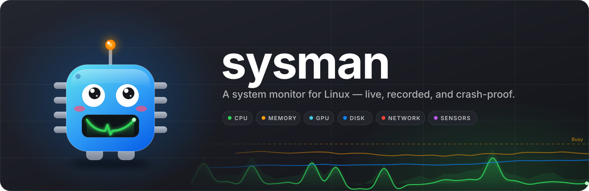

<p align="center"></p>

# sysman

A system monitor for Linux desktops: a small collector daemon that records what
your machine is doing, and a native app that shows it live and as history.

- **`sysmand`** runs as a user service. Every 2 seconds it samples CPU, memory,
  pressure, sensors, GPUs, disks, network, processes and more. It keeps a crash
  log on disk (every line forced to disk, so the last readings before a freeze
  or power cut survive), stores history in SQLite, and serves live data over a
  Unix socket.
- **`sysman`** is a GPUI desktop app that reads that data.

No root is needed for either. Status: the collector is complete and in daily
use; the app has its Dashboard, Processes, GPU, Network and Disk tabs, with
Energy, Hardware, Explorer, Insights, Groups and Disk Map still to come.

## Hardware support

| | Supported | Verified on hardware |
| --- | --- | --- |
| CPU | x86: AMD (k10temp, zenpower) and Intel (coretemp, hybrid P/E cores) | AMD Ryzen 9 7950X3D |
| NVIDIA GPU | NVML, falling back to `nvidia-smi` if NVML hangs | RTX 4090 |
| AMD GPU | amdgpu sysfs and hwmon, per-process use from DRM fdinfo | Raphael iGPU |
| Intel GPU | i915 and xe sysfs, hwmon, fdinfo | fixtures only |
| Other | any hwmon sensor, NVMe, btrfs, batteries and peripherals | |

Backends without hardware here are tested against fixtures built from the
kernel documentation and are marked unverified.

## Install

Requires Linux, a recent stable Rust (edition 2024) and, for the app, a Wayland
or X11 session with Vulkan.

```bash
git clone <this repository> sysman && cd sysman

# collector, as a systemd user service
cargo install --path crates/sysmand
cp dist/sysmand.service ~/.config/systemd/user/
systemctl --user daemon-reload
systemctl --user enable --now sysmand

# app
cargo build --release -p sysman
./target/release/sysman
```

Check the collector:

```bash
systemctl --user status sysmand
journalctl --user -u sysmand -e      # startup and collector errors
sysmand --once                       # print one meta and one sample, write nothing
```

## Where things live

| What | Path |
| --- | --- |
| Config | `~/.config/sysman/config.toml` (optional; defaults apply without it) |
| History | `~/.local/share/sysman/history.db` |
| Crash log | `~/.local/share/sysman/log/YYYY-MM-DD.jsonl` |
| Socket | `$XDG_RUNTIME_DIR/sysman.sock` |
| Service | `~/.config/systemd/user/sysmand.service` |

`XDG_CONFIG_HOME` and `XDG_DATA_HOME` are honoured.

## Configuration

Every setting has a default, so the file is optional. Unknown sections, modules
or keys stop the daemon at startup with a message naming them, so a typo cannot
silently switch something off. Apply changes with
`systemctl --user restart sysmand`.

```toml
[general]
interval = 2            # base tick in whole seconds; no module runs more often
fsync = true            # force each crash-log line to disk

[retention]
log_days = 2            # crash log: today and yesterday
raw_hours = 48          # full-resolution history
rollup_1m_days = 90     # 1-minute min/avg/max
rollup_15m_days = 730   # 15-minute min/avg/max
proc_rollup_days = 7    # per-process 1-minute history

[modules.processes]     # every module also accepts `enabled` and `interval`
top_n = 20
```

### Modules

| Module | Interval | Collects | Options (default) |
| --- | --- | --- | --- |
| `system` | 2 s | load, uptime, tasks, context switches, interrupts, forks, open files | |
| `cpu` | 2 s | total and per-state use, per-core use and frequency, package and CCD/core temperatures, RAPL power where readable, topology | `per_core` (true), `frequency` (true) |
| `memory` | 2 s | RAM and swap breakdown, paging, OOM kills, zram, ZFS ARC | |
| `pressure` | 2 s | PSI stall time for CPU, memory, I/O, IRQ | |
| `hwmon` | 2 s | every board sensor: temperatures, fans, voltages, power | `chip_intervals` (`{ nct67 = 10 }`) |
| `gpu` | 2 s | per-device utilisation, memory, temperature, power, clocks, fan, throttling; per-process use | `processes` (true) |
| `disk` | 2 s | per-drive throughput, IOPS, latency, busy time, queue depth | `partitions` (false), `exclude` (`["loop"]`) |
| `net` | 2 s | per-interface rates, errors, drops, Wi-Fi signal; TCP and sockets | `exclude` (`["lo", "veth"]`) |
| `processes` | 10 s | every process (stored as history) and top lists by CPU, memory, I/O | `top_n` (10), `io` (true), `groups` (true), `cmdline_max` (200) |
| `cgroups` | 10 s | top apps, services and containers by CPU and memory | `top_n` (10) |
| `fs` | 30 s | space and inodes per filesystem (bind mounts and subvolumes counted once) | `exclude_fstypes` (`["squashfs", "iso9660"]`) |
| `netinfo` | 60 s | addresses, link state, default routes, DNS | `exclude` (`["lo", "veth"]`) |
| `storage` | 60 s | drive inventory and state, btrfs device errors and missing devices | `exclude` (`["loop", "zram"]`) |
| `power` | 60 s | batteries, AC, peripheral batteries | |

`exclude` lists are name prefixes. `chip_intervals` maps hwmon chip-name
prefixes to seconds: some Super I/O chips (nct67xx) cost several percent of a
core when read every 2 s, so they are read every 10 s by default.

Measured cost with defaults: about 2% of one core.

## After a crash or power cut

The crash log is plain JSON Lines, one record per tick, written before the next
tick starts. Open the file for that day and read the last lines before the gap:

```bash
f=~/.local/share/sysman/log/$(date +%F).jsonl
tail -1 "$f" | jq .                                          # latest sample
jq -c 'select(.type=="sample") | [.time, .cpu.temp_c, .gpu.devices[]?.temp_c]' "$f"
jq -c 'select(.errors) | [.time, .errors]' "$f"              # collector failures
```

- Temperatures climbing, or fan/pump RPM falling: cooling.
- Everything flat and normal to the last line: power supply or cabling.
- A burst of `gpu` errors or timeouts first: the GPU or its driver hung.

Every start writes a `meta` record with `modules.system.info.boot_id`; a new
boot id after a gap marks a reboot.

## Live data

The socket speaks line-delimited JSON, one request and one response per line:

```bash
echo '{"cmd":"latest"}' | socat - UNIX-CONNECT:$XDG_RUNTIME_DIR/sysman.sock | jq .cpu
```

| Request | Response |
| --- | --- |
| `{"cmd":"meta"}` | static information: hardware, topology, units, limits |
| `{"cmd":"latest"}` | the newest value of every module |
| `{"cmd":"subscribe"}` | meta, then every record as it is produced |
| `{"cmd":"processes"}` | the full process table now |

History is read directly from `history.db` (SQLite, WAL mode; open it
read-only). The record format and table layout are in [DESIGN.md](DESIGN.md)
and `crates/schema`.

## Limits

Without root, these are not collected: SMART health and wear, CPU package power
on most systems (RAPL is root-only), disk I/O and open files of other users'
processes, and per-process network traffic. The app shows them as "not
permitted" rather than as zero.

## Development

```
crates/schema    record types, DB schema and series naming shared by daemon and app
crates/sysmand   the collector daemon
crates/sysman    the GPUI app
dist/            systemd unit
docs/            app design and research
```

```bash
cargo test                 # the whole workspace
cargo clippy --all-targets
cargo fmt
```

Collectors read `/proc` and `/sys` through a root that tests point at fixture
trees, so most behaviour is tested without the hardware.

Debug builds of the app read a few environment variables for screenshots and
checks; release builds ignore them:

| Variable | Effect |
| --- | --- |
| `SYSMAN_DEV_TAB=<Tab>` | open on that tab |
| `SYSMAN_DEV_OPEN_AFTER_DATA=1` | open the window only once its data has loaded |
| `SYSMAN_DEV_SELECT=<comm>` | select that process in Processes |
| `SYSMAN_DEV_HIERARCHY=1` | start Processes in hierarchy mode |
| `SYSMAN_DEV_EXPAND=<iface>` | expand that adapter in Network |
| `SYSMAN_DEV_APP_ID=<id>` | use another Wayland app id |

Design: [DESIGN.md](DESIGN.md) (collector) and
[docs/APP-DESIGN.md](docs/APP-DESIGN.md) (app).

## License

MIT, as declared in `Cargo.toml`.
